&nbsp;&nbsp;

&nbsp;&nbsp;

<!-- ==================== SECTION 1: HERO BANNER ==================== -->

  

 

<!-- ==================== SECTION 2: WHAT I BUILD ==================== -->
## What I build

*    
*    
*    
*    
*    

