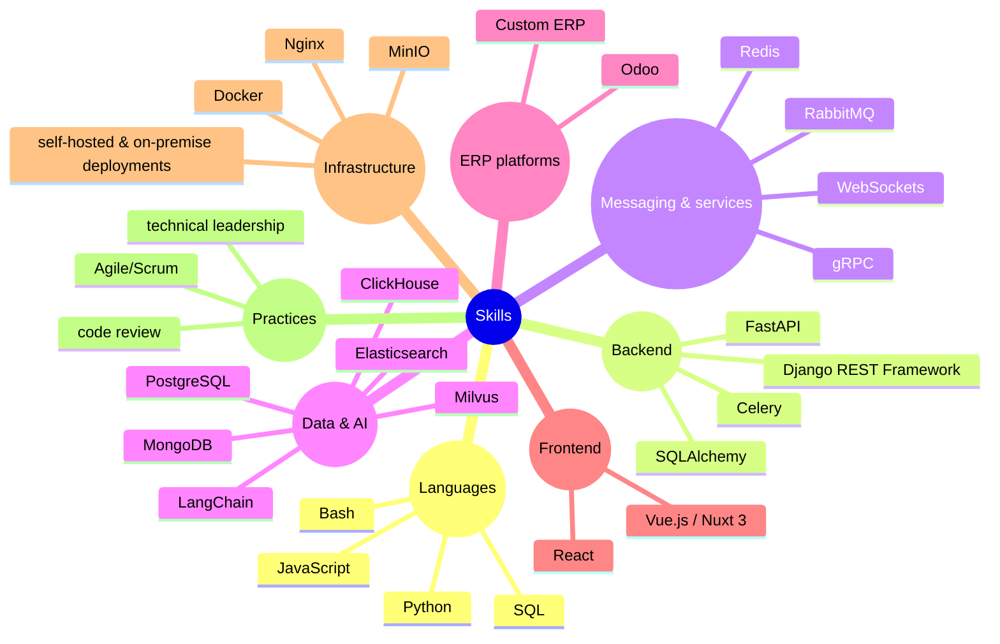

&nbsp;&nbsp;
&nbsp;&nbsp;
&nbsp;&nbsp;
&nbsp;

<!-- ==================== SECTION 1: HERO BANNER ==================== -->

  

<!-- ==================== SECTION 2: WHAT I BUILD ==================== -->
## What I build

-    
-    
-    
-    
-    
 
<!-- ==================== SECTION 3: Tech Stack ==================== -->

<!-- ==================== SECTION 4: Selected Work ==================== -->

## Selected Work

Most of my production work is private (client and company systems), so the repositories below are public, sanitized examples of the same patterns.

| **PROJECT** |  **ENGINEERING FOCUS** |
|:--|:--|
|  |  |
|  | |
|  |  |
|  |  |
|  |  |

<!-- ==================== Footer Tech Stack & Architecture ==================== -->
## Tech Stack & Architecture

