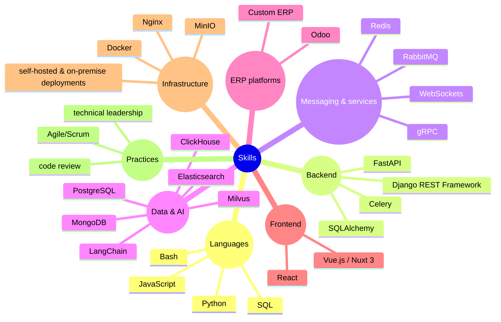

&nbsp;&nbsp;
&nbsp;&nbsp;
&nbsp;&nbsp;

<!-- ==================== SECTION 1: HERO BANNER ==================== -->

  

**Senior Software Engineer | ERP Systems & Business Process Automation | Odoo, Python (Django, FastAPI) | AI on Enterprise Data**

7+ years building enterprise back-end systems for healthcare, logistics and SaaS: multi-module ERPs, workflow automation, secure access control and AI on business data.

<!-- ==================== SECTION 2: WHAT I BUILD ==================== -->
## What I build

-    
-    
-    
-    
-    

---

<!-- ==================== SECTION 3: SKILLS ==================== -->

<!-- ==================== SECTION 4: SELECTED WORK ==================== -->
## Selected Work

> Most of my production work is private (client and company systems). These are public repositories:

| **PROJECT** | **ENGINEERING FOCUS** |
|:--|:--|
|  |  |
|  |  |
|  |  |

<!-- ==================== FOOTER: TECH ICONS ==================== -->
---

